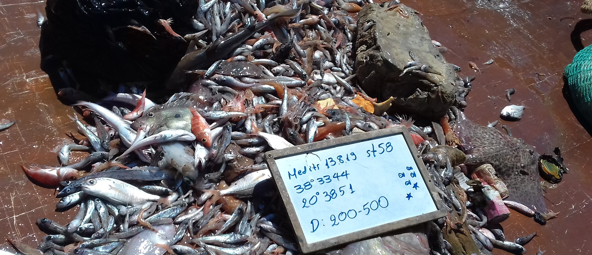

# PETS Detection with YOLO26



*Example image from the PETS dataset.*

This project contains code and supporting files for detecting sharks and skates
in the PETS dataset. The `pets_training.py` script supports experiments with
YOLO26-L and YOLO26-X using the same dataset and training settings. Each run
trains and evaluates only one selected model.

## Training and evaluation

Choose the model by setting `MODEL_VARIANT` near the beginning of
`pets_training.py` to `"l"` or `"x"`. The matching pretrained weights and
experiment name are configured together:

| Model | Pretrained weights | Experiment name |
| --- | --- | --- |
| YOLO26-L | `yolo26l.pt` | `pets_y26_large_<image-size>_<batch-size>` |
| YOLO26-X | `yolo26x.pt` | `pets_y26_xlarge_<image-size>_<batch-size>` |

The experiment name is generated from the selected model, `IMG`, and
`BATCH_SIZE`. With the current settings (`IMG = 640` and `BATCH_SIZE = 24`),
the names are `pets_y26_large_640_24` and `pets_y26_xlarge_640_24`.

The selected model is trained using `pets.yaml`. Each model uses the same
settings and two NVIDIA GPUs (`device=[0, 1]`):

| Setting | Value |
| --- | --- |
| Image size | 640 |
| Epochs | 300 |
| Batch size | 24 |
| Early-stopping patience | 40 |
| Confidence threshold for validation and prediction | 0.1 |
| Random seed | 42 |

Vertical and horizontal flips and dropout are disabled. The model is validated
on the train, validation, and test splits. The script then predicts on the test
images, saves prediction outputs, and prints the mAP50 for each split. Run the
script again with the other `MODEL_VARIANT` value to perform the other
experiment.

### Run the script

From the parent workspace directory, install dependencies and make sure the
pretrained `yolo26l.pt` and `yolo26x.pt` weights and the dataset are available:

```bash
pip install -r pets-detection/requirements.txt
```

The script uses the independent test image directory at
`/home/politikos/datasets/pets_create_train_val_test_set/images/test`. Update
`TEST_IMAGES` in `pets_training.py` if the dataset is stored elsewhere.

Run it from the `pets-detection` directory so `pets.yaml` is found:

```bash
cd pets-detection
python pets_training.py
```

The script requests GPUs 0 and 1 for training. Although it reports whether CUDA
is available, its training configuration does not automatically switch to CPU
or a single GPU.

## Dataset and classes

The dataset configuration is `pets.yaml`. It uses separate `train`, `val`, and
`test` directories under `../../datasets/pets_create_train_val_test_set`; the
validation set has 59 images and the independent test set has 31. Keep these
splits separate when selecting settings and reporting final test results. Its
classes are:

- `shark`
- `skate`

Update the dataset paths in `pets.yaml` to match your local dataset layout.
The dataset and trained checkpoints are not included in this repository.

## Inference and evaluation

`pets_inference.py` evaluates the configured YOLO26 runs. It reads each run's
training image size from `args.yaml`, chooses a shared confidence threshold by
maximizing mean per-class F1 across pooled train and validation predictions,
then applies that threshold to train, validation, and test. The test split is
not used to select the threshold. Run it from this directory:

```bash
python pets_inference.py
```

The script expects trained checkpoints in the parent workspace's
`../runs/detect/` directory. It writes `pets_inference_metrics.csv`,
`pets_inference.log`, and detailed inference artifacts under this folder's
`runs/pets_inference/`.

For the selected YOLO26l-960-16 experiment, run the focused evaluation:

```bash
python pets_y26l_960_optimal_inference.py
```

This evaluates train, validation, and test at 960px with one shared
train+validation-selected confidence threshold. It saves confidence curves,
precision-recall curves, confusion matrices, prediction labels, class counts,
and a validation-versus-test metrics plot under
`runs/pets_inference/YOLO26l-960-16_optimal/`.

Both scripts use YOLO26's native end-to-end inference path without adding a
separate NMS postprocessing step.

## Explainability

The `lrp/` directory contains Layer-wise Relevance Propagation helpers, and
`pets_explainability.py` is the explainability entry point.

## Project files

```text
pets-detection/
├── pets.yaml
├── pets_training.py       # Selectable YOLO26-L or YOLO26-X experiment
├── pets_inference.py      # Evaluate saved runs and select thresholds
├── pets_y26l_960_optimal_inference.py # Focused YOLO26l-960-16 evaluation
├── pets_explainability.py
├── lrp/
├── sample_images/
└── requirements.txt
../pets_code.py            # Same YOLO26 workflow in the parent workspace
```
